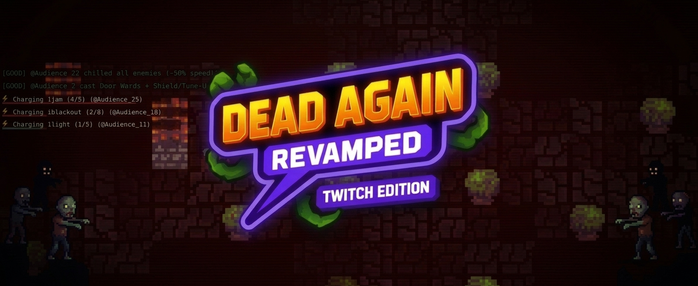
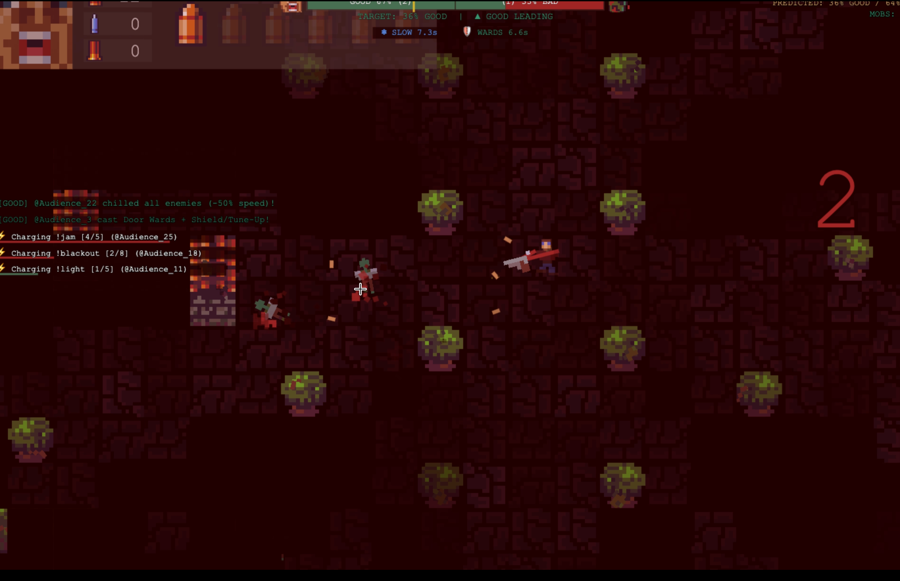
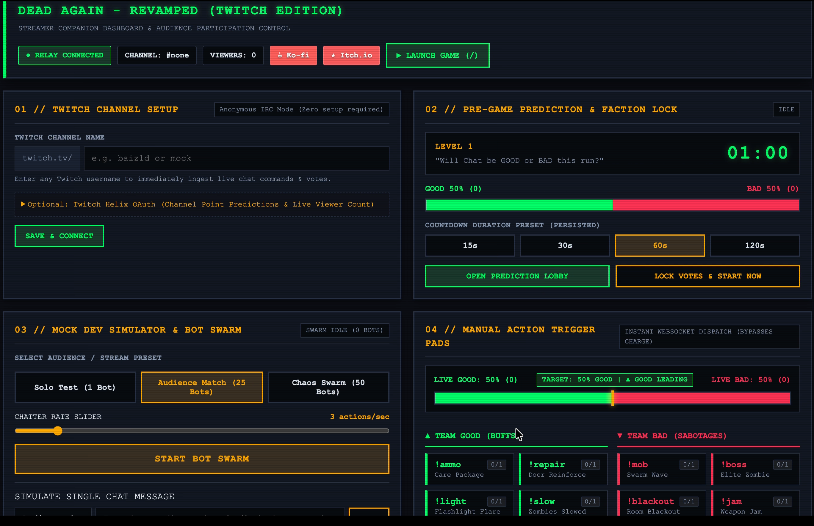

<p align="center">
  
</p>

<h3 align="center">Retro Top-Down Zombie Survival Shooter with Native Twitch Audience Participation</h3>

<p align="center">
  <a href="https://github.com/BAIZ1D/dead-again-revamped/releases"></a>
  <a href="#downloads-and-releases"></a>
  <a href="LICENSE"></a>
  <a href="LICENSE-THIRD-PARTY.txt"></a>
  <a href="https://ko-fi.com/baiz1d"></a>
  <a href="https://baiz1d.itch.io/dead-again-revamped"></a>
</p>

---

## Overview

**Dead Again - Revamped (Twitch Edition)** is a standalone desktop survival shooter engineered specifically for live streaming. A single player battles escalating undead hordes on their primary broadcast monitor while their live Twitch chat audience directly influences the match through real-time chat commands, predictions, and crowd mechanics.

Your audience splits into two competing factions in a continuous tug-of-war:
- **Team Good**: Deploys emergency ammunition drops, reconstructs protective barriers, casts healing seals, and activates frost slows.
- **Team Bad**: Summons aggressive zombie waves, spawns armored elite bosses, triggers sensory blackouts, and temporarily jams the streamer's firearms.

The entire experience runs locally through a high-performance native desktop architecture—no web overlays, no browser source latency, and zero OBS performance bottlenecks.

---

## Dual-Display Broadcast Architecture

Dead Again - Revamped coordinates two specialized windows designed for multi-monitor streaming workflows:

<table width="100%">
  <tr>
    <th width="50%" align="center">Primary Game Window (Monitor 1)</th>
    <th width="50%" align="center">Companion Streamer Dashboard (Monitor 2)</th>
  </tr>
  <tr>
    <td valign="top">
      
      <p><b>Stream this window via OBS Studio Window Capture</b></p>
      <ul>
        <li>Locked 16:9 cinematic aspect ratio (720p / 1080p).</li>
        <li>Unthrottled 60 FPS rendering with background occlusion bypass.</li>
        <li>In-game spectator HUD: live audience chat feed, dynamic red kill counter, and karma status.</li>
      </ul>
    </td>
    <td valign="top">
      
      <p><b>Keep this window private on your second monitor</b></p>
      <ul>
        <li>Direct Twitch IRC chat and Channel Points bridge.</li>
        <li>Real-time spectator karma meter with tug-of-war balance.</li>
        <li>Offline bot swarm simulator for practice and rehearsals.</li>
        <li>Instant ability trigger pads and manual override controls.</li>
      </ul>
    </td>
  </tr>
</table>

---

## Audience Chat Commands & Actions

Viewers participate directly by typing standard chat commands in the streamer's Twitch channel. As audience size grows, abilities automatically scale with viewer charges to maintain competitive tension.

| Command | Faction | Base Cooldown | In-Game Effect |
|---|---|---|---|
| `!ammo` | Team Good | 3 seconds | Airdrops an emergency survivor care package containing 12 bullets and weapon clips. |
| `!repair` | Team Good | 3 seconds | Rebuilds surrounding barricades and reinforces boarded doorways. |
| `!light` | Team Good | 3 seconds | Illuminates dark arena sectors and grants the player a temporary speed burst. |
| `!slow` | Team Good | 3 seconds | Chills active undead with a frost aura, reducing enemy movement speed by 40%. |
| `!barrier` | Team Good | 5 seconds | Deploys an octagonal kinetic push ring that repels nearby zombies. |
| `!mob` | Team Bad | 3 seconds | Spawns a concentrated strike team of aggressive runner zombies. |
| `!boss` | Team Bad | 8 seconds | Summons a heavily armored elite boss zombie with massive health and damage. |
| `!jam` | Team Bad | 8 seconds | Sabotages the streamer's active firearm, forcing an emergency clearing cycle. |
| `!blackout` | Team Bad | 5 seconds | Extinguishes arena lighting, plunging the battlefield into temporary shadow. |
| `!frenzy` | Team Bad | 5 seconds | Enrages all active zombies into an aggressive high-speed pursuit sprint. |

---

## Spectator Karma & Prediction System

Matches feature integrated spectator voting that ties directly into Twitch Channel Points and IRC chat:

| Feature | Mechanism | Streamer Impact |
|---|---|---|
| **Lobby Predictions** | Viewers vote `!good` or `!bad` during level intermissions. | Stakes Channel Points on match survival or streamer defeat. |
| **Dynamic Karma Ratio** | Tracks ratio of positive versus negative audience actions. | Visual tug-of-war meter shifts dynamically on both displays. |
| **Audience Scaling** | Action thresholds scale automatically based on viewer count. | Prevents spam in large channels while keeping small streams active. |
| **Fail-Safe Safeguards** | Push refunds on early deaths (fewer than 3 actions) or exact ties. | Ensures fair Channel Point distribution for viewers. |

---

## Weapon Arsenal & Ballistics Specification Matrix

Dead Again - Revamped features a fine-tuned ballistic model designed to reward disciplined trigger control during high-intensity zombie swarms:

| Weapon | Capacity | Fire Mode | Cyclic Rate | Spread / Bloom | Ballistic Characteristics |
|---|---|---|---|---|---|
| **Handgun (Pistol)** | 6 rounds | Semi-Auto | Player-paced | Zero bloom ($0^\circ$) | Reliable starting sidearm; precise single-shot targeting. |
| **Shotgun** | 2 rounds | Double Barrel | Pump blast | Fixed conical spray | Fires 8 heavy buckshot pellets per blast with wide radial spread; devastating stopping power in close quarters. |
| **Machine Pistol (SMG)** | 20 rounds | Select-Fire (Burst / Hold) | 80ms cyclic (~12.5 shots/s; empty mag in ~1.52s) | Burst: $S \le 0.02$ rad ($\approx 1.15^\circ$)<br>Hold Bloom: $\pm 0.48$ rad ($\approx 27.5^\circ$) | **Dual-Profile Recoil Engine:**<br>- *3-Shot Burst Taps:* Pinpoint laser accuracy ($S \le 0.02$ rad) with zero screenshake.<br>- *Continuous Hold Spray:* 80ms high-cadence buzzsaw with escalating non-linear bloom cone ($\pm 0.48$ rad), $\pm 8\%$ velocity jitter, and micro-screenshake.<br>- *Trigger Reset Window:* 160ms trigger release pause resets bloom counter to initial pinpoint precision. |

---

## In-Game HUD Architecture & Ergonomics

The in-game heads-up display is optimized for both streamer situational awareness and live spectator clarity:

- **Top-Left Equipment Card:**
  - **Chambered Ammo 2x10 Micro-Pip Grid:** Weapons with $>6$ round capacity (Machine Pistol / SMG) wrap into a clean 2-row x 10-column micro-pip grid ($0.52 \cdot \text{scaleUI}$, $0.50 \cdot \text{scaleUI}$ horizontal pitch, $0.54 \cdot \text{scaleUI}$ vertical pitch), contained strictly inside the top-left equipment box and eliminating crosshair overflow. Spent rounds dim to 20% opacity (`colorWhite.scale(0.2)`).
  - **Avatar-Anchored Health Telemetry:** Player health pips (3 base pixel hearts and 1 golden shield pip) render directly beneath the player avatar in world space (`pos.y - 1.35 * scaleUI`) with a dark armored backing plate (`rgba(0, 0, 0, 0.45)`). Includes biological heartbeat double-pulse at 1 HP (`0.28 \cdot \sin(...)` and `0.16 \cdot \sin(...)` with red-ghosting highlight).
  - **Total Reserve Ammo Counters:** Clear digital counter displays total remaining reserve rounds per weapon type.

---

## Dynamic Center Notification Banners

Twitch APG events and major match shifts trigger broadcast-grade notification banners with adaptive geometry:

- **Adaptive Container Dimensions:** Center notification banners dynamically calculate container height (`u * 2.4` for single-line headline vs `u * 3.4` for dual-line headline + subtitle).
- **Relative Text Anchoring:** Headline anchored to `bannerPos.y - u * 0.45` and subtitle anchored to `bannerPos.y + u * 0.55`, eliminating vertical clipping on Divine Flash & Blood Surge.
- **Responsive Text Downscaling:** Banner width capped at 92% screen width (`W * 0.92`) with proportional font downscaling for long Twitch usernames (`scale = Math.min(1.0, maxTextW / measuredW)`).

---

## Start Screen Retro Arcade Visual Overhaul & In-Game Field Manual

The title and menu experience features procedural retro arcade visuals and instant in-game reference:

- **Heraldic Hero Crest:** Procedural Canvas 2D heater shield with faceted 3D shading, royal gold trim (`#D4AF37`), crossed Shotgun ($-35^\circ$) and SMG ($+35^\circ$) tiles with specular glints, and split Tug-of-War insignia (Golden Star vs Crimson Skull glyph separated by a glowing 2px center seam).
- **Opposing Faction Portraits:** Dynamic idle floating portraits ($\pm 3$px sinusoidal movement) flanking the crest—Survivor portrait with golden divine aura (`#FBF236`) vs Zombie face with crimson miasma aura (`#AC3232`).
- **Arcade Atmosphere:** 24 procedural rising ember particles with organic horizontal sine flutter, authentic horizontal CRT scanlines every 3px (alpha 0.055), dark-crimson perimeter radial vignette, and chromatic typography glows (Twitch-purple `#9146FF` and blood-red) with a 4-second specular sheen sweep on the subtitle ribbon.
- **In-Game Field Manual & Streamer Guide Modal (`[H]`):** Canvas 2D immediate-mode terminal card with 3 navigable tabs:
  - Tab 1: *Combat & Weapons* (ballistics, burst fire vs hold bloom, ammo drops).
  - Tab 2: *Twitch APG & Audience Mechanics* (Tug-of-War, Karma meter, chat commands, Divine Flash & Blood Surge).
  - Tab 3: *Streamer Setup & Quick Start* (dual-window layout, OBS window capture, hotkeys).

---

## Unified Multi-Input Controls Matrix

Play seamlessly with full keyboard, mouse, and controller support:

| Action | Keyboard | Mouse | Gamepad |
|---|---|---|---|
| **Move Survivor** | `W`, `A`, `S`, `D` / Arrow Keys | — | Left Analog Stick |
| **Aim & Look** | — | Mouse Cursor | Right Analog Stick |
| **Fire Active Weapon** | Left Mouse Button | Left Click | Right Trigger (`RT`) / Button `R2` |
| **Select Handgun (Pistol)** | `1` | — | D-Pad Left |
| **Select Shotgun** | `2` | — | D-Pad Up |
| **Select Machine Pistol (SMG)** | `3` | — | D-Pad Right |
| **Open Field Manual & Guide** | `H` | Click `[H] HOW TO PLAY` | Button `Y` / `Triangle` |
| **Start Match / Primary CTA** | `Enter` / `Space` | Click `CLICK TO SURVIVE` | Button `A` / `Cross` |
| **Close Modal / Back** | `Esc` | Click `[ESC / X] RETURN` | Button `B` / `Circle` |
| **Manual Tab Switching** | `1`, `2`, `3` / `Left`, `Right` | Click Tab Header | Left/Right Bumpers (`LB` / `RB`) |
| **Toggle Streamer Dashboard** | `Cmd+D` (macOS) / `Ctrl+D` (Win) or `F1` | — | — |

---

## Downloads & Releases

Pre-compiled standalone binaries for macOS and Windows are available on the [Releases](https://github.com/BAIZ1D/dead-again-revamped/releases) page:

| Operating System | Package Type | Architecture | Launch Details |
|---|---|---|---|
| **macOS** | `.dmg` Installer | Universal (Apple Silicon & Intel) | Drag-and-drop bundle with bundled `Fix Gatekeeper.command` helper. |
| **macOS** | `.zip` Archive | Universal (Apple Silicon & Intel) | Standalone portable `.app` bundle. |
| **Windows** | `.exe` Setup | x64 | Zero-admin installer targeting `%LOCALAPPDATA%` with desktop shortcuts. |
| **Windows** | `.zip` Portable | x64 | Portable standalone folder—extract and run `Dead Again - Revamped.exe`. |

---

## Streamer Quick-Start

For detailed instructions on configuring OBS Studio Window Capture, bypassing security prompts, and setting up Twitch credentials:

See the comprehensive guide: **[STREAMER_GUIDE.md](STREAMER_GUIDE.md)**

### macOS Quick Setup:
1. Open the downloaded `.dmg` and drag the application to `/Applications`.
2. Double-click **`Fix Gatekeeper.command`** in the disk image to clear the macOS quarantine attribute.
3. Launch the game, open the dashboard (`Cmd+D` or `F1`), enter your channel name, and go live!

### Windows Quick Setup:
1. Run `Dead Again - Revamped Setup.exe`.
2. If Microsoft Defender SmartScreen appears, click **More info** followed by **Run anyway**.
3. Launch the game, press `Ctrl+D` or `F1` to open the dashboard, and connect your Twitch channel!

---

## Technical Architecture

```
+---------------------------------------------------------------------------------+
|                               ELECTRON DESKTOP SHELL                            |
|                                                                                 |
|  +-------------------------------------+   +---------------------------------+  |
|  |       PRIMARY GAME WINDOW           |   |   STREAMER DASHBOARD WINDOW     |  |
|  |                                     |   |                                 |  |
|  |   - LittleJS Canvas Engine (2D)     |   |   - Real-time Karma Radar       |  |
|  |   - Procedural Levels & Pathing     |   |   - Bot Swarm Controls          |  |
|  |   - In-Game Spectator HUD           |   |   - Twitch Connection Manager   |  |
|  |   - Low-latency Audio Synthesizer   |   |   - Action Override Pads        |  |
|  +------------------^------------------+   +----------------^----------------+  |
|                     |                                       |                   |
|                     +-------------------+-------------------+                   |
|                                         | WebSocket                             |
|  +--------------------------------------v------------------------------------+  |
|  |                         LOCAL RELAY SUPERVISOR                            |  |
|  |                                                                           |  |
|  |   - Express HTTP Server (Port 8080 or dynamic fallback)                   |  |
|  |   - WebSocket Broadcast Hub                                               |  |
|  |   - Twitch IRC Integration (tmi.js)                                       |  |
|  |   - Twitch Helix API Client (@twurple)                                    |  |
|  |   - Action Queue & Dynamic Cooldown Engine                                |  |
|  |   - Simulated Bot Swarm Generator                                         |  |
|  +---------------------------------------------------------------------------+  |
+---------------------------------------------------------------------------------+
```

---

## Building from Source

### Prerequisites
- Node.js 20 or later
- npm 10 or later

### Build Instructions
```bash
# Clone the repository
git clone https://github.com/BAIZ1D/dead-again-revamped.git
cd dead-again-revamped

# Install dependencies
npm install

# Compile the game source files
npm run build

# Generate high-resolution icons and presentation assets
npm run generate-icons

# Launch in local development mode
npm run dev:desktop

# Package standalone distributions
npm run pack:mac   # Builds macOS Universal DMG and ZIP
npm run pack:win   # Builds Windows x64 NSIS installer and portable ZIP
```

---

## Release Notes & Changelog

### Version 1.2.0 (Milestone v1.5)

Dead Again - Revamped v1.2.0 delivers major tactical combat refinements, ergonomic HUD redesigns, and a complete retro arcade visual overhaul:

1. **Tactical Combat Balancing:**
   - Machine Pistol (SMG) transformed into high-velocity spray weapon with 20-round chamber capacity and 80ms cyclic rate (~12.5 shots/s; full mag dumped in ~1.52s).
   - Dual-profile recoil engine: 3-shot burst taps preserve laser accuracy ($S \le 0.02$ rad / $\approx 1.15^\circ$) with zero camera shake; continuous hold trigger escalates non-linear bloom cone up to $\pm 0.48$ rad ($\approx 27.5^\circ$) with $\pm 8\%$ velocity jitter and micro-screenshake.
   - 160ms trigger release pause reset window fully restores laser pinpoint accuracy.

2. **HUD Ergonomics & Anti-Clipping:**
   - SMG chambered ammo wrapped into a 2-row x 10-column micro-pip grid ($0.52 \cdot \text{scaleUI}$) contained strictly within equipment card box, eliminating bullet icon overflow.
   - Player health pips relocated beneath avatar portrait in world space (`pos.y - 1.35 * scaleUI`) with dark armored backing plate and 1 HP double-beat biological pulse.
   - Center notification banners dynamically calculate container dimensions (`u * 2.4` single vs `u * 3.4` dual-line) and anchor text relative to box center, eliminating subtitle clipping on Divine Flash & Blood Surge across 720p, 1080p, and 4K viewports.
   - Repaired text outline stroke styling polymorphism (`drawTextWithOutline` supporting 5- and 6-argument calls) resolving numeric `strokeStyle` assignments.

3. **Start Screen Retro Arcade Visual Overhaul:**
   - Procedural Canvas 2D heraldic crest with crossed Shotgun and SMG tiles at $\pm 35^\circ$ with specular glints.
   - Floating Survivor vs Zombie portraits with $\pm 3$px idle sinusoidal bobbing and faction auras.
   - 24 procedural rising ember particles with upward drift, horizontal sine flutter, and boundary fade.
   - Authentic 3px CRT scanlines and dark-crimson perimeter radial vignette.
   - Layered chromatic typography glows (Twitch-purple `#9146FF` and blood-red) with 4-second specular sheen sweep on subtitle ribbon.
   - In-game Canvas 2D tabbed Field Manual & Streamer Guide overlay (`[H]`) with 3 navigable tabs.

4. **Distribution & Standalone Engine Integrity:**
   - Synchronized version `1.2.0` across all package manifests and desktop updater/menu routines.
   - Zero-dependency standalone architecture compiling all 30 source modules cleanly into `main/dist/js/index.js`.
   - 100% green test passes across all 7 repository verification suites (Phase 12, 13, 15, 16, 17, Packaging, Distribution).

---

## Support the Developer

Dead Again - Revamped (Twitch Edition) is created and maintained by **Baizid Al Hamid ([BAIZ1D](https://github.com/BAIZ1D))**.

- ☕ **Support on Ko-fi**: [ko-fi.com/baiz1d](https://ko-fi.com/baiz1d) — Direct developer support for ongoing updates and server hosting.
- **Itch.io Game Page**: [baiz1d.itch.io/dead-again-revamped](https://baiz1d.itch.io/dead-again-revamped) — Rate the game and share reviews.
- **Issue Tracker**: [GitHub Issues](https://github.com/BAIZ1D/dead-again-revamped/issues) — Bug reports and feature suggestions.

---

## Licensing & Attribution

This project is licensed under the **GNU Affero General Public License v3.0 (GNU AGPLv3)**. See the [LICENSE](LICENSE) file for complete copyleft terms and conditions.

### Third-Party Permissive Notices
Dead Again - Revamped builds upon and modifies open-source permissive components:
- **Dead Again** (Original Game): Created by **Jonas Olmstead** and **Jesper Rasmussen**, with original soundtrack composed by **Andrei Moskvitin Josephsen** — Licensed under the **MIT License**.
- **LittleJS 2D Web Game Engine**: Created by **Frank Force** — Licensed under the **MIT License**.
- **ZzFX & ZzFXM (Sound & Music Synthesizers)**: Created by **Frank Force** and **Keith Clark** — Licensed under the **MIT License**.
- **Runtime Dependencies**: `@twurple/api`, `@twurple/auth`, `tmi.js`, `express`, `ws`, `cors`, and `electron-store` are distributed under their respective **MIT Licenses**.

Complete third-party copyright statements and notices are preserved in [LICENSE-THIRD-PARTY.txt](LICENSE-THIRD-PARTY.txt).
