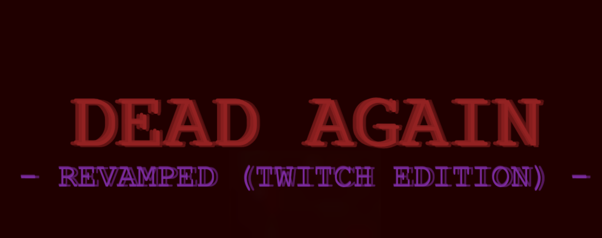

<p align="center">
  
</p>

<h3 align="center">Retro Top-Down Zombie Survival Shooter with Native Twitch Audience Participation</h3>

<p align="center">
  <a href="https://github.com/BAIZ1D/dead-again-revamped/releases"></a>
  <a href="#downloads-and-releases"></a>
  <a href="LICENSE"></a>
  <a href="LICENSE-THIRD-PARTY.txt"></a>
  <a href="https://ko-fi.com/baiz1d"></a>
  <a href="https://baiz1d.itch.io/dead-again-revamped"></a>
</p>

---

## Overview

**Dead Again - Revamped (Twitch Edition)** is a standalone desktop survival shooter engineered specifically for live streaming. A single player battles escalating undead hordes on their primary broadcast monitor while their live Twitch chat audience directly influences the match through real-time chat commands, predictions, and crowd mechanics.

Your audience splits into two competing factions in a continuous tug-of-war:
- **Team Good**: Deploys emergency ammunition drops, reconstructs protective barriers, casts healing seals, and activates frost slows.
- **Team Bad**: Summons aggressive zombie waves, spawns armored elite bosses, triggers sensory blackouts, and temporarily jams the streamer's firearms.

The entire experience runs locally through a high-performance native desktop architecture—no web overlays, no browser source latency, and zero OBS performance bottlenecks.

---

## Dual-Display Broadcast Architecture

Dead Again - Revamped coordinates two specialized windows designed for multi-monitor streaming workflows:

<table width="100%">
  <tr>
    <th width="50%" align="center">Primary Game Window (Monitor 1)</th>
    <th width="50%" align="center">Companion Streamer Dashboard (Monitor 2)</th>
  </tr>
  <tr>
    <td valign="top">
      
      <p><b>Stream this window via OBS Studio Window Capture</b></p>
      <ul>
        <li>Locked 16:9 cinematic aspect ratio (720p / 1080p).</li>
        <li>Unthrottled 60 FPS rendering with background occlusion bypass.</li>
        <li>In-game spectator HUD: live audience chat feed, dynamic red kill counter, and karma status.</li>
      </ul>
    </td>
    <td valign="top">
      
      <p><b>Keep this window private on your second monitor</b></p>
      <ul>
        <li>Direct Twitch IRC chat and Channel Points bridge.</li>
        <li>Real-time spectator karma meter with tug-of-war balance.</li>
        <li>Offline bot swarm simulator for practice and rehearsals.</li>
        <li>Instant ability trigger pads and manual override controls.</li>
      </ul>
    </td>
  </tr>
</table>

---

## Audience Chat Commands & Actions

Viewers participate directly by typing standard chat commands in the streamer's Twitch channel. As audience size grows, abilities automatically scale with viewer charges to maintain competitive tension.

| Command | Faction | Base Cooldown | In-Game Effect |
|---|---|---|---|
| `!ammo` | Team Good | 3 seconds | Airdrops an emergency survivor care package containing 12 bullets and weapon clips. |
| `!repair` | Team Good | 3 seconds | Rebuilds surrounding barricades and reinforces boarded doorways. |
| `!light` | Team Good | 3 seconds | Illuminates dark arena sectors and grants the player a temporary speed burst. |
| `!slow` | Team Good | 3 seconds | Chills active undead with a frost aura, reducing enemy movement speed by 40%. |
| `!barrier` | Team Good | 5 seconds | Deploys an octagonal kinetic push ring that repels nearby zombies. |
| `!mob` | Team Bad | 3 seconds | Spawns a concentrated strike team of aggressive runner zombies. |
| `!boss` | Team Bad | 8 seconds | Summons a heavily armored elite boss zombie with massive health and damage. |
| `!jam` | Team Bad | 8 seconds | Sabotages the streamer's active firearm, forcing an emergency clearing cycle. |
| `!blackout` | Team Bad | 5 seconds | Extinguishes arena lighting, plunging the battlefield into temporary shadow. |
| `!frenzy` | Team Bad | 5 seconds | Enrages all active zombies into an aggressive high-speed pursuit sprint. |

---

## Spectator Karma & Prediction System

Matches feature integrated spectator voting that ties directly into Twitch Channel Points and IRC chat:

| Feature | Mechanism | Streamer Impact |
|---|---|---|
| **Lobby Predictions** | Viewers vote `!good` or `!bad` during level intermissions. | Stakes Channel Points on match survival or streamer defeat. |
| **Dynamic Karma Ratio** | Tracks ratio of positive versus negative audience actions. | Visual tug-of-war meter shifts dynamically on both displays. |
| **Audience Scaling** | Action thresholds scale automatically based on viewer count. | Prevents spam in large channels while keeping small streams active. |
| **Fail-Safe Safeguards** | Push refunds on early deaths (fewer than 3 actions) or exact ties. | Ensures fair Channel Point distribution for viewers. |

---

## Downloads & Releases

Pre-compiled standalone binaries for macOS and Windows are available on the [Releases](https://github.com/BAIZ1D/dead-again-revamped/releases) page:

| Operating System | Package Type | Architecture | Launch Details |
|---|---|---|---|
| **macOS** | `.dmg` Installer | Universal (Apple Silicon & Intel) | Drag-and-drop bundle with bundled `Fix Gatekeeper.command` helper. |
| **macOS** | `.zip` Archive | Universal (Apple Silicon & Intel) | Standalone portable `.app` bundle. |
| **Windows** | `.exe` Setup | x64 | Zero-admin installer targeting `%LOCALAPPDATA%` with desktop shortcuts. |
| **Windows** | `.zip` Portable | x64 | Portable standalone folder—extract and run `Dead Again - Revamped.exe`. |

---

## Streamer Quick-Start

For detailed instructions on configuring OBS Studio Window Capture, bypassing security prompts, and setting up Twitch credentials:

See the comprehensive guide: **[STREAMER_GUIDE.md](STREAMER_GUIDE.md)**

### macOS Quick Setup:
1. Open the downloaded `.dmg` and drag the application to `/Applications`.
2. Double-click **`Fix Gatekeeper.command`** in the disk image to clear the macOS quarantine attribute.
3. Launch the game, open the dashboard (`Cmd+D` or `F1`), enter your channel name, and go live!

### Windows Quick Setup:
1. Run `Dead Again - Revamped Setup.exe`.
2. If Microsoft Defender SmartScreen appears, click **More info** followed by **Run anyway**.
3. Launch the game, press `Ctrl+D` or `F1` to open the dashboard, and connect your Twitch channel!

---

## Technical Architecture

```
+---------------------------------------------------------------------------------+
|                               ELECTRON DESKTOP SHELL                            |
|                                                                                 |
|  +-------------------------------------+   +---------------------------------+  |
|  |       PRIMARY GAME WINDOW           |   |   STREAMER DASHBOARD WINDOW     |  |
|  |                                     |   |                                 |  |
|  |   - LittleJS Canvas Engine (2D)     |   |   - Real-time Karma Radar       |  |
|  |   - Procedural Levels & Pathing     |   |   - Bot Swarm Controls          |  |
|  |   - In-Game Spectator HUD           |   |   - Twitch Connection Manager   |  |
|  |   - Low-latency Audio Synthesizer   |   |   - Action Override Pads        |  |
|  +------------------^------------------+   +----------------^----------------+  |
|                     |                                       |                   |
|                     +-------------------+-------------------+                   |
|                                         | WebSocket                             |
|  +--------------------------------------v------------------------------------+  |
|  |                         LOCAL RELAY SUPERVISOR                            |  |
|  |                                                                           |  |
|  |   - Express HTTP Server (Port 8080 or dynamic fallback)                   |  |
|  |   - WebSocket Broadcast Hub                                               |  |
|  |   - Twitch IRC Integration (tmi.js)                                       |  |
|  |   - Twitch Helix API Client (@twurple)                                    |  |
|  |   - Action Queue & Dynamic Cooldown Engine                                |  |
|  |   - Simulated Bot Swarm Generator                                         |  |
|  +---------------------------------------------------------------------------+  |
+---------------------------------------------------------------------------------+
```

---

## Building from Source

### Prerequisites
- Node.js 20 or later
- npm 10 or later

### Build Instructions
```bash
# Clone the repository
git clone https://github.com/BAIZ1D/dead-again-revamped.git
cd dead-again-revamped

# Install dependencies
npm install

# Compile the game source files
npm run build

# Generate high-resolution icons and presentation assets
npm run generate-icons

# Launch in local development mode
npm run dev:desktop

# Package standalone distributions
npm run pack:mac   # Builds macOS Universal DMG and ZIP
npm run pack:win   # Builds Windows x64 NSIS installer and portable ZIP
```

---

## Support the Developer

Dead Again - Revamped (Twitch Edition) is created and maintained by **Baizid Al Hamid ([BAIZ1D](https://github.com/BAIZ1D))**.

- ☕ **Support on Ko-fi**: [ko-fi.com/baiz1d](https://ko-fi.com/baiz1d) — Direct developer support for ongoing updates and server hosting.
- **Itch.io Game Page**: [baiz1d.itch.io/dead-again-revamped](https://baiz1d.itch.io/dead-again-revamped) — Rate the game and share reviews.
- **Issue Tracker**: [GitHub Issues](https://github.com/BAIZ1D/dead-again-revamped/issues) — Bug reports and feature suggestions.

---

## Licensing & Attribution

This project is licensed under the **GNU Affero General Public License v3.0 (GNU AGPLv3)**. See the [LICENSE](LICENSE) file for complete copyleft terms and conditions.

### Third-Party Permissive Notices
Dead Again - Revamped builds upon and modifies open-source permissive components:
- **Dead Again** (Original Game): Created by **Jonas Olmstead** and **Jesper Rasmussen**, with original soundtrack composed by **Andrei Moskvitin Josephsen** — Licensed under the **MIT License**.
- **LittleJS 2D Web Game Engine**: Created by **Frank Force** — Licensed under the **MIT License**.
- **ZzFX & ZzFXM (Sound & Music Synthesizers)**: Created by **Frank Force** and **Keith Clark** — Licensed under the **MIT License**.
- **Runtime Dependencies**: `@twurple/api`, `@twurple/auth`, `tmi.js`, `express`, `ws`, `cors`, and `electron-store` are distributed under their respective **MIT Licenses**.

Complete third-party copyright statements and notices are preserved in [LICENSE-THIRD-PARTY.txt](LICENSE-THIRD-PARTY.txt).
